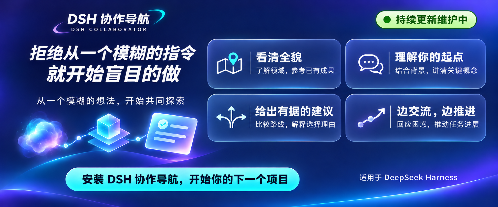

<p align="center"><a href="./README.md">简体中文</a> · <strong>English</strong></p>

<h1 align="center">DSH Collaborator</h1>

<p align="center"><strong>Build shared understanding, then move the work forward.</strong></p>
<p align="center">Chinese project name: DSH协作助手 · In-app name: DSH 协作导航 · Actively maintained</p>

<p align="center"><a href="https://github.com/X-Roman-666/dsh-collaborator/releases/latest">Download & install</a> · <a href="#what-it-helps-you-do">Features</a> · <a href="#try-a-real-conversation">Example</a> · <a href="https://github.com/X-Roman-666/dsh-collaborator/issues">Issues & suggestions</a></p>


You start with a rough idea. The AI immediately writes code and adds features. Hours later, you still cannot tell whether the approach makes sense, and the result is getting harder to understand.

**DSH Collaborator helps you and DeepSeek Harness develop a shared understanding and keep making progress through conversation.** For unfamiliar or complex projects, it guides DSH to explain the landscape, find relevant work, understand your starting point, and explain technical choices. Clear, small tasks are handled directly.



## What it helps you do

| Capability | What it looks like in practice |
| --- | --- |
| **See the landscape** | Explain how project components fit together and introduce approaches with relevant papers, open-source projects, products, research teams, and community work. Include links and specific takeaways. |
| **Understand your starting point** | Distinguish your experience, current understanding, and specific questions. Explain necessary concepts before asking questions that affect decisions. |
| **Make informed choices** | Compare approaches, explain recommendations and their conditions, and connect references to practical work. |
| **Keep talking and progressing** | Adapt explanations and actions to feedback; retain goals, references, decisions, and progress within the current session. |

**Explaining a concept, sharing a link, and establishing that the user understands it are treated separately.** Sharing resources does not automatically establish understanding. An unknown background does not require a mandatory assessment.

Useful for exploring a new field, planning research, comparing approaches, and developing a product idea. Start with “I want to build…” or give DSH a specific task.

## Download and install

**Package: [dsh-collaborator-0.1.5.tgz](https://github.com/X-Roman-666/dsh-collaborator/releases/download/v0.1.5/dsh-collaborator-0.1.5.tgz)** · [All releases](https://github.com/X-Roman-666/dsh-collaborator/releases) · [Repository mirror](https://github.com/X-Roman-666/dsh-collaborator/raw/refs/heads/main/downloads/dsh-collaborator-0.1.5.tgz)

Requires a **DeepSeek Harness (DSH) 0.2.2 prerelease**. Service integration tests cover `0.2.2-rc.1` and `0.2.2-rc.3`; the declared range is `>=0.2.2-rc.1 <0.2.3`.

1. Download the `.tgz` file and leave it compressed.
2. In DSH, open **Plugins → Add plugin**, paste the **absolute local path**, install it, and enable it. Uninstall the older version before upgrading.
3. Fully quit DSH through **Application → Quit**, then reopen it to reload the plugin.
4. Open a new session and run `/collaborate status`. Check for version `0.1.5` and enabled collaboration monitoring and shared-understanding guidance. Status labels may appear in Chinese.

Example path:

```text
D:\Downloads\dsh-collaborator-0.1.5.tgz
```

Enable DSH’s **web search and fetching** tools to retrieve papers, projects, and web references.

<details>
<summary>Command-line installation</summary>

Run from the package directory:

```powershell
dsh plugin --profile desktop add ./dsh-collaborator-0.1.5.tgz --ignore-scripts
```

Replace `desktop` with `web` for a web profile. If `dsh` is not on PATH, use the desktop installer.

</details>

## Try a real conversation

Start a new session:

> I want to build a website like Meshy, Tripo, or Hyper3D. How should I approach it?

DSH should explain how the web interface, model-generation service, and asset processing fit together, introduce relevant existing work, and learn about your experience and intended use.

Then add:

> I know a little Python, but I have never built a website. I do not understand whether the 3D model is generated in the browser or on a server.

It should address the question, adjust the depth of its explanation, and move ahead with useful work. Look for **help understanding and choosing**, rather than setup questions followed immediately by a complete codebase.

Also try “Make this sentence more concise.” Clear tasks should be completed directly. More checks are available in the [Chinese conversation acceptance examples](./examples/acceptance.md).

## Commands

| Command | Purpose |
| --- | --- |
| `/collaborate your task` | Start a task. Natural-language instructions also work. |
| `/collaborate status` | Show the loaded version, guidance status, and current record. |
| `/collaborate off` | Pause guidance in this session. |
| `/collaborate on` | Resume guidance in this session. |

Commands require the host commands service. The `collaboration` tool remains available without it.

## How it works and where data lives

The plugin adds system-prompt guidance, a session checkpoint tool, and dynamic communication reminders. It uses the model and tools enabled in DSH. **The plugin itself makes no extra model requests, sends no telemetry, and collects no API keys.** Conversational behavior depends on the selected model and tools.

Records are stored in the **current DSH session** and restored with that session. Separate sessions do not automatically share project memory. Monitoring provides reminders at a later model-generation opportunity and does not interrupt running tools.

## Development and feedback

The repository contains source, guidance, tests, posters, and the installable package. JavaScript is shipped directly; no build is required.

```powershell
npm install
npm run check
npm test
npm pack
```

Entry point: [src/index.js](./src/index.js). Guidance: [prompts/collaborator.md](./prompts/collaborator.md). Details: [Chinese development guide](./docs/DEVELOPMENT.zh-CN.md). Changes: [CHANGELOG.md](./CHANGELOG.md).

Report issues with your DSH version, loaded plugin version, reproduction steps, and relevant errors in [Issues](https://github.com/X-Roman-666/dsh-collaborator/issues). For behavior feedback, share an example with private details removed and describe the expected explanation or action.

**Actively maintained.** The package declares `UNLICENSED`; this repository does not yet grant an open-source license.
