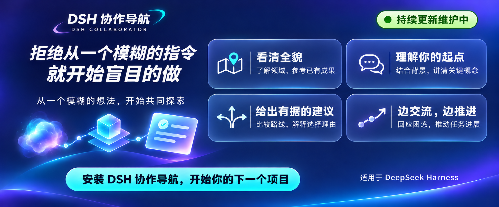

<p align="center"><strong>简体中文</strong> · <a href="./README.en.md">English</a></p>

<h1 align="center">DSH协作助手</h1>

<p align="center"><strong>先理解，再推进。让 DeepSeek Harness 更懂你的项目，也让你更清楚下一步。</strong></p>
<p align="center">插件内名称：DSH 协作导航 · DSH Collaborator · 持续更新维护中</p>

<p align="center"><a href="https://github.com/X-Roman-666/dsh-collaborator/releases/latest">下载安装</a> · <a href="#它能帮你做什么">功能介绍</a> · <a href="#试一次真实对话">对话示例</a> · <a href="https://github.com/X-Roman-666/dsh-collaborator/issues">问题与建议</a></p>


你只有一个初步想法，AI 却立刻开始写代码、加功能。做了很久，你仍然不知道方向是否合适，结果也越来越难理解。

**DSH协作助手帮助你与 AI 先建立共同理解，再在交流中推进工作。** 面对陌生或复杂项目，它引导 DSH 解释领域全貌、查找已有成果、了解你的实际起点，并说明技术选择的依据。需求明确的小任务仍然直接处理。



## 它能帮你做什么

| 能力 | 在实际对话中做什么 |
| --- | --- |
| **看清全貌** | 解释项目各部分之间的关系与主要路线，结合相关论文、开源项目、公司产品、研究团队和社区成果，给出参考链接及借鉴点。 |
| **理解你的起点** | 区分你的相关经验、对项目的理解和具体困惑，先解释必要概念，再提出容易回答、确实影响选择的问题。 |
| **给出有据的建议** | 比较可选路线，说明推荐理由、适用条件和下一步工作，让资料能够支持实际判断。 |
| **边交流，边推进** | 根据反馈调整讲解与行动，在同一会话中保存目标、资料、决定和进展，发现具体困惑后继续回应。 |

**“已经介绍过”“已经提供资料”和“用户已经理解”分别对待。** 不会因为发过几个链接，就默认你掌握了整个项目；也不会因为某个背景尚不清楚，就要求你先完成一套测评。

适合进入陌生领域、探索研究方向、比较技术方案，以及把产品想法推进成项目。你可以从“我想做一个……”开始，也可以直接交给它一项明确任务。

## 下载与安装

**安装包：[dsh-collaborator-0.1.5.tgz](https://github.com/X-Roman-666/dsh-collaborator/releases/download/v0.1.5/dsh-collaborator-0.1.5.tgz)** · [所有版本](https://github.com/X-Roman-666/dsh-collaborator/releases) · [备用下载](https://github.com/X-Roman-666/dsh-collaborator/raw/refs/heads/main/downloads/dsh-collaborator-0.1.5.tgz)

运行于 **DeepSeek Harness（DSH）0.2.2 预发布版**；服务集成测试覆盖 `0.2.2-rc.1` 和 `0.2.2-rc.3`。声明的兼容范围为 `>=0.2.2-rc.1 <0.2.3`。

1. 下载 `.tgz` 安装包，保留文件格式，不用解压。
2. 打开 DSH 左侧 **插件 → 添加插件**，粘贴下载文件的**完整本地路径**，点击安装并启用。更新时先卸载旧版，再安装新版。
3. 通过 **应用 → 退出** 完整退出 DSH，再重新打开，以重新加载插件。
4. 新建会话，输入 `/collaborate status`，确认实际加载版本为 `0.1.5`，并显示“持续协作监测：已启用”“共同理解引导：已启用”。

例如，下载文件保存到 `D:\Downloads` 时，应填写：

```text
D:\Downloads\dsh-collaborator-0.1.5.tgz
```

需要检索论文、项目和网页资料时，请同时启用 DSH 的**网页搜索与获取**工具。

<details>
<summary>使用命令行安装</summary>

在安装包所在目录执行：

```powershell
dsh plugin --profile desktop add ./dsh-collaborator-0.1.5.tgz --ignore-scripts
```

Web 配置将 `desktop` 换成 `web`。如果 `dsh` 未加入 PATH，使用桌面端插件安装入口。

</details>

## 试一次真实对话

新建会话，发送：

> 我想做一个类似 Meshy、Tripo、Hyper3D 的网站，应该怎么做？

它应先帮你理解网页界面、模型生成服务、资产处理等部分之间的关系，结合已有成果介绍路线，再自然了解你的经验与用途。

接着发送：

> 我会一点 Python，没做过网站，也不清楚模型是在网页里生成，还是在服务器上生成。

它应解释这个具体困惑，调整讲解深度，并继续推进你当前能够完成的工作。观察重点是**是否帮助你理解和选择**，而不是问过几个参数后就生成整套代码。

还可以测试“把这句话改得简洁一些”这类明确的小任务：它应该直接完成。更多行为检查见 [对话验收示例](./examples/acceptance.md)。

## 常用命令

| 命令 | 用途 |
| --- | --- |
| `/collaborate 任务描述` | 开始一项任务。也可以直接用自然语言描述。 |
| `/collaborate status` | 查看实际加载版本、协作状态和当前任务记录。 |
| `/collaborate off` | 暂停当前会话的协作引导。 |
| `/collaborate on` | 恢复当前会话的协作引导。 |

命令需要宿主提供 commands 服务；没有该服务时，对话中的 `collaboration` 工具仍可使用。

## 工作方式与数据

插件通过系统提示扩展、会话记录工具和动态沟通提醒工作，使用 DSH 已启用的模型及工具。**插件本身不另开模型请求、不发送遥测、不收集 API 密钥。** 实际讲解与协作表现取决于所用模型和工具。

目标、背景、资料、决定和进展记录在**当前 DSH 会话**中，随宿主会话保存和恢复。不同会话各自独立，新会话不会自动继承其他会话的项目记忆。持续协作监测在后续模型生成时提供提醒，不会中断正在运行的工具。

## 开发与反馈

仓库包含插件源码、协作规则、测试、海报原图及可安装包。包内直接提供 JavaScript，无需构建。

```powershell
npm install
npm run check
npm test
npm pack
```

实现入口：[src/index.js](./src/index.js)；协作规则：[prompts/collaborator.md](./prompts/collaborator.md)；详细说明：[开发说明](./docs/DEVELOPMENT.zh-CN.md)；更新记录：[CHANGELOG.md](./CHANGELOG.md)。

遇到问题，请在 [Issues](https://github.com/X-Roman-666/dsh-collaborator/issues) 提供 DSH 版本、插件实际加载版本、复现步骤和相关报错。对话效果反馈可以提供去除私密内容后的示例，说明你期待的讲解或行动。

**持续更新维护中。** 当前包的许可声明为 `UNLICENSED`，本仓库尚未授予开源许可。
